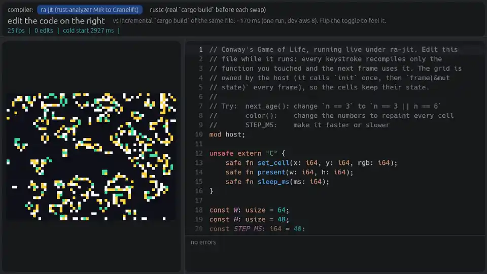

# ra-jit

> [!IMPORTANT]
> **There are no plans for long-term support of ra-jit. We weren't aware of [rustd](https://github.com/DioxusLabs/rustd) when we built it, and you should probably use that instead.** It takes the same approach (rust-analyzer front end, Cranelift, per-function recompiles on edit) and is further along: it works on real crates as a drop-in `cargo rustd build/run/test`, while ra-jit only runs a small subset of Rust.

Hot-reload Rust in milliseconds, using rust-analyzer as the compiler front end.

```
nix run github:indexable-inc/ra-jit
```



[mp4](docs/demo.mp4)

Edit the source on the right and the Game of Life on the left changes on the next frame, with its state intact. A toggle switches to a real `cargo build` per edit for comparison.

> [!WARNING]
> **This is an experiment.** It only runs what rust-analyzer can lower to MIR and what ra-jit can translate. Today that is a small subset of Rust: no `dyn`, closures, heap, `std`/`fmt`, drops, unwinding or real `i128`, and no overflow or bounds checks. rust-analyzer has only partial borrow checking, so code rustc rejects may still run here. Keep running `cargo check`; rustc + LLVM stay the compiler for release builds and CI.

## How it works

- **Front end:** rust-analyzer keeps the workspace in a long-lived, in-memory incremental database (salsa), so an edit re-analyses only what it touches.
- **Codegen:** ra-jit translates rust-analyzer's MIR for each function into Cranelift IR, and Cranelift's JIT emits machine code into memory. There is no LLVM and no linker.
- **Hot reload:** every call goes through a table of function pointers. On an edit, only functions whose MIR, layouts or callee signatures changed are recompiled, and their slots are repointed.
- **State:** the host owns it. The guest declares `fn init() -> Life` and `fn frame(l: &mut Life)`. The host runs `init` once and passes the same memory to `frame` every frame, so state survives swaps. If `Life`'s layout changes, the host re-runs `init`.

## Numbers

One run on one machine (dev-aws-8), median of 20 edits, edit-to-swap vs incremental debug `cargo build`:

| edit | ra-jit | `cargo build` |
|---|---|---|
| one-file edit | ~7 ms | ~169 ms |
| +300 generated functions | ~60 ms | ~282 ms |

Cold start is about 3 s, mostly rust-analyzer analysing `core`.

## Build

`nix run` builds each crate as its own Nix derivation from cargo's unit graph, so editing ra-jit doesn't rebuild rust-analyzer or Cranelift. After changing `Cargo.toml` or `Cargo.lock`, regenerate the graph with `python3 tools/unit_graph.py`.

Without nix: nightly-2026-07-15 with `rust-src`, then `cargo build --release && ./target/release/ra-jit life`.

## Thanks

[rust-analyzer](https://github.com/rust-lang/rust-analyzer) does the hard part (parsing, types, traits, layouts, MIR). [Cranelift](https://cranelift.dev/) generates the code. [egui](https://github.com/emilk/egui) draws the window.

Design notes and next steps: [`docs/plan.md`](docs/plan.md).

## About

Built at [ix](https://ix.dev), where we run VMs with 100+ vCPUs for exactly this kind of build-heavy work. If that sounds interesting, get in touch at andrew@ix.dev.

MIT or Apache-2.0.
