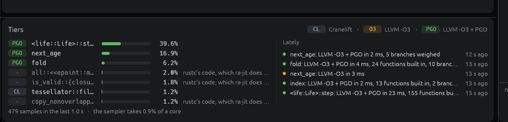

# Tiers

A program that takes edits with `ra-jit-live` is also made faster while it runs. The daemon
samples where its threads are, compiles the functions it spends its time in again with LLVM,
and swaps them in as patches, the way HotSpot or V8 tier up, without a restart
([#6](https://github.com/indexable-inc/ra-jit/issues/6)). macOS on Apple silicon only, as
live edits are; it needs a ra-jit built with `--features llvm`.

## The levels

| | Name in code and UI | What compiles it | What it is for |
|---|---|---|---|
| 1 | `Level::Cranelift`, "Cranelift" (`CL`) | Cranelift, one function at a time | every build and every edit: about 5 ms from the save to the running program |
| 2 | `Level::Llvm`, "LLVM -O3" (`O3`) | LLVM at `-O3`, with what the function calls built in where that is hot or small | a hot function, about a second after it gets hot; it counts its branches |
| 3 | `Level::Pgo`, "LLVM -O3 + PGO" (`PGO`) | the same IR again, with what level 2 counted given to LLVM as `!prof` | a level-2 function that has counted for a second |

The names are `ra_jit_live::format::LEVELS`, which the daemon's events and the window share.

## How it goes

1. **The program samples itself.** The worker that links a program's executable writes
   `sample` in the program's directory (`~/.cache/ra-jit/live/<uuid>/`). The program's
   `ra-jit-live-sample` thread then looks at one busy thread in turn every 2 ms
   (`thread_get_state`, which stops the thread while it reads), counts the address it was
   at if that is the program's own code or a patch's, and writes `profile` four times a
   second: the counts since it started, the CPU it took itself, and the counters level-2
   code counts in. Without `sample` the thread only looks for it, every 250 ms. `sample`
   names the worker that reads `profile`; once that process is gone (it exited, crashed or
   was killed, none of which removes the file) the program samples nothing until a worker
   asks again.
2. **The worker puts each address in a function** (`crates/ra-jit/src/tier.rs`): the
   executable's own symbol table, or, for an address in the room for patches, the function
   a live patch put there in place of the executable's (`Baseline::live` says where each
   went). It keeps a second of samples per function.
3. **It asks for the hot ones.** A function with 2% of the samples in the last second, and
   at least 10 of them, is asked for at level 2, four at a time at most. A function at level
   2 that has counted for a second and was entered at least 50 times is asked for at level 3.
   Every function that has had 0.3% of the samples is one that may be built into what is
   compiled. Code that is not the daemon's (rustc's copies of the dependencies) is shown at
   level 0 and is not asked for again.
4. **The worker compiles them beside its builds** (`compile_tiered` in `main.rs`) on a
   thread of its own: it builds the IR of each with a copy of the database
   (`hir_ty::mir::codegen::tier::prepare`), lets go of the database, and only then runs LLVM
   (`Prepared::finish`), so a change to the source never waits for LLVM. It keeps the code
   with the program (`Rejections::tiers`), and builds a patch as an edit's is built. A
   tiered function differs from the last full build, so the patch has it at its level; it
   is spliced into the executable and published to the program, which writes a jump over
   the old entry. The program writes nothing it was not already writing.
5. **It says what it did**: `tiers` in the program's directory (`format::Tiers`, read with
   `ra_jit_live::tiers()`) has each hot function's level, share of the samples and what is
   under way, and the last events; the worker's log has the same events as `tier:` lines.

### What is built in

Cranelift's code calls every function but the smallest of the standard library. At level 2
the IR is built again with the calls of a hot function, or of any function whose built body
is at most 600 Cranelift instructions, replaced by the body (`tier::inline_limit`,
`tier::hot_body`), up to 10 deep and 40 000 instructions in all. A body is measured with its
locals out of the frame (`promote`), as its caller has them, not as built, where every local
goes through a stack slot. That crosses crates: the standard library's iterators, slice
indexing and its `ub_checks`, closures, and `#[track_caller]` functions (their body takes
the caller's location as the call passed it). Without this LLVM has nothing to work with:
per-function `-O3` of the benchmark below runs at 50 generations per second, 2.5 times
Cranelift.

What the function itself calls and does not build in, LLVM is shown the body of
(`tier::seen_body`, up to 10 000 instructions in all): a hot `#[inline(never)]` function,
which stays a call (`noinline`) as rustc keeps it; one too large for the limit above (up to
4000 instructions if hot, 2000 if not), which LLVM builds in itself where its own measure,
taken after it optimized the body, finds it small enough; and drop glue. Each body is a
function of the module beside the one compiled. LLVM infers from it what a call it keeps
does (that it does not unwind, what it reads and writes, that it keeps no pointer it is
given) and optimizes the caller with that; before code is emitted every copy left is
replaced by the function itself and dropped. An edit of a body shown demotes the caller, as
an edit of one built in does.

### What LLVM is told

Cranelift's IR has only integers. What `llvm/lower.rs` writes of it gives LLVM what rustc
would have:

- **Reference parameters** carry what their types say, as rustc's
  `arg_attrs_for_rust_scalar` marks them: `noalias` for a `&mut T` of an `Unpin` `T` and for
  a `&T` without an `UnsafeCell`, `readonly` for the latter, `dereferenceable` (the size of
  `T`), `align`, `nonnull` and `noundef`. Only references to plain data (scalars, pointers,
  references, arrays, tuples and structs and enums of those) are marked, and no parameter
  of a coroutine body: one is resumed with a null context to drop it. An aggregate passed or
  returned in memory is `dereferenceable` and aligned, and where a value is returned to is
  `nocapture`.
- **Addresses are pointers.** A value used as an address, what it is computed from, what a
  block parameter or the place of a stack slot holds of one, and an argument that is one,
  are `ptr`: each access is then based on the address it is based on. An integer turned
  into a pointer where it is used could be based on anything, and a pointer turned into an
  integer is one LLVM takes to escape, after which it can say nothing of what it points to.
- **Branches are threaded first.** A call Cranelift built in returns through a block that
  joins its returns, and the caller branches on what came back there (an `Option`'s
  discriminant); left to the default pipeline the join becomes a `select` and a loop over a
  range counts with `i + (i < n)`, which LLVM neither unrolls nor proves an index of in
  bounds or free of overflow with. Threaded, it counts with `i + 1`.
- **`noalias` becomes scopes.** On Mach-O the function is built into a function of the same
  signature that only calls it. LLVM's inliner then turns each `noalias` parameter into
  `!alias.scope`/`!noalias` metadata, working out along the paths through the function where
  the address has not escaped yet. Its loop passes take an address that escapes anywhere to
  escape everywhere; with the scopes they know that a call in a loop leaves `&mut self`'s
  fields alone when `self` is passed on only after the loop, and keep the fields in registers.

### Profile-guided optimization

Level-2 code counts how often it is entered and, for each two-way branch of its IR in the
order of the layout, how often it went each way: `select(condition, a, b)` picks the counter,
so a branch costs one increment. The counters are `ra_jit_live_counters()`, a 64 K array in
every program that links `ra-jit-live`, called by name; the worker hands out ranges of it.
Level 3 builds the same IR (the same functions built in), finds the same branches in the
same order, and gives LLVM `!prof !{"branch_weights", taken, not}` on each and
`!{"function_entry_count", n}` on the function; it counts nothing. When the branches do not
line up (they always have so far), level 3 is compiled without weights.

### Edits and tiers

An edit wins. A tiered function's code is kept with the print of the Cranelift code of the
function and of every function built into it. The build after an edit asks for those prints
(Cranelift compiles the edited function anyway, which is what it would have done), and a
function whose print or one of whose built-in functions' prints changed is at level 1 again
in that same build: the edit is not held up by LLVM. The worker tells the watcher, which
starts the function over; it is compiled again once it is hot again, typically a second
later. A full build (a type changed, a link) sends every function back to level 1.

Nor does an edit wait for a compile under way. Applying a change to the database waits for
every other handle on it to be let go of, and the thread that compiles at a higher level
holds one only while it builds the IR, which the change cancels at its next query; LLVM runs
after the handle is dropped. Code it finishes from IR an edit made stale is caught by the
prints above and not used. The worker logs `tier-timing:` for each compile, the time with
the database and LLVM's without.

### What is not replaced

- A frame that is running a function finishes in the code it started in; the next call runs
  the new code. There is no on-stack replacement, so a loop that never returns from the
  function it is in is never sped up. The Life demo calls `step()` once a generation.
- Shims (drop glue, vtable and `FnOnce` shims) stay at level 1.
- A function a caller of level 2 or 3 has built in is not called from there any more, and
  an edit of it demotes the caller too.

### The store

Code of level 2 or 3 is never put in the store: it depends on the profile and on what was
hot, which no key of an entry names. It is kept in the worker for as long as the program
runs, and a new daemon starts every function at level 1.

## Turning it off

`RA_JIT_TIER=off` in the daemon's environment starts none of it: no program is asked to
sample, no function leaves level 1, and the worker says `tier: off` in its log.
`RA_JIT_TIER=off` in a program's own environment keeps it from sampling.
`RA_JIT_TIER=2` stops at level 2, which then counts nothing. `RA_JIT_DUMP_TIER=1` has the
worker print the IR of each tiered function and why a body was not built in.

## Measured

`demo/lifebench` (the Game of Life of `demo/life` on a 512 × 512 grid, run flat out) on an
M-series Mac under load from other builds, 2026-10-20, with `harness/tierbench.py`: runs of
25 seconds, steady state the mean of the half-second rates from 15 s on, each build the
median of three rounds that take turns (the `outline` and all-LLVM rows: of two).

| Build | Generations per second | vs release | Before this round of work |
|---|---|---|---|
| level 1, Cranelift (`RA_JIT_TIER=off`) | 23 | 2.0% | 21 |
| every function LLVM `-O3`, nothing built in (`RA_JIT_BACKEND=llvm RA_JIT_OPT=3`) | 57 | 5.0% | 50 |
| level 2, LLVM -O3 (`RA_JIT_TIER=2`) | 772 | 68% | 482 |
| level 3, LLVM -O3 + PGO (default) | 763 | 68% | 528 |
| rustc `-O3` with `overflow-checks` and `debug-assertions`, `step` kept out of `main` | 951 | 84% | |
| rustc `-O3` with `overflow-checks` and `debug-assertions`, the semantics of the dev profile | 965 | 85% | 890 |
| rustc release (`cargo build --release`) | 1129 | 100% | 1130 |

rustc debug (`cargo build`) ran at 20 in the earlier measurement and was not run again.

- **Against the fair ceiling:** level 3 is at 79% of the build that keeps the dev profile's
  overflow checks and debug assertions, which the tiered code has to keep, and at 68% of a
  release build. Before, 59% and 47%. A tier compiles `step` alone and cannot build it into
  the `main` that runs it; rustc's own code does as well with `step` kept out of `main`
  (951) as with it built in, so that is not where the gap is.
- **Level 3 against level 2:** about the same now (763 and 772, within the noise of the
  machine). The branch counts helped LLVM lay out code it could not see through; with the
  addresses and the aliasing told it, they add nothing here.
- **Time to each level:** `neighbours` at level 2 at 0.6 s and `step` at 0.9 s; level 3 at
  1.6 s and 2.0 s. A compile at level 2 or 3 takes 1 to 60 ms (`step` with 166 functions
  built in or shown: 56 ms, then 28 ms), of which `step` spends 20 ms building its IR with
  the database and the rest in LLVM without it.
- **While level 2 counts** (about a second), the counting is in the hot loop; in the earlier
  measurement the rate was 50 to 80 generations per second then.
- **Edits:** from the save to the new executable, 6.4 ms (median of 24, 6.1 to 7.8) with
  tiering off and 6.9 ms (4.9 to 8.7) while functions are tiered, demoted by the edits and
  tiered again; the program applies a patch in 0.25 ms (0.22 to 0.42). An edit that arrives
  while a function is compiled at a higher level does not wait for LLVM: with LLVM's part of
  each compile stretched to a second, every edit took 4.7 to 10 ms, where holding the
  database through LLVM, as before, made the edits that came meanwhile wait 0.9 to 3.9 s.
- **Sampler:** 0.8 to 0.9% of one core at 500 Hz with one or two busy threads, 1.3 to 1.5%
  at 1000 Hz (earlier measurement). Killing the worker that reads it stops it within a
  quarter of a second.
- **Output:** what the tiered program prints is cargo's, checksum for checksum
  (`harness/tiers.py`).

### Where the rest of the gap is

The issue's mark is within 10% of a release build. A release build does not check overflow,
and code that panics on overflow cannot be swapped for code that wraps, so the tiered code
can reach the checked build at most: 85% of release here. Level 3 is at 79% of that. What
is left, as far as it was looked at:

- `next`, the new grid, is a local `Vec` whose pointer and length are read again for every
  cell. Its drop on the way out of a panic is a call of drop glue requested from a body
  Cranelift built in, which LLVM is not shown, so its address escapes for the whole
  function and the call of `next_age` in the loop may write it. rustc's drop glue is in the
  same module, and LLVM sees it keeps no pointer. Showing drop glue at every depth did not
  reach this call and was dropped.
- An access says no alignment unless Cranelift's IR flags it, so LLVM takes every load of
  the grid to be unaligned (`align 1`). It costs little on AArch64; it was not measured.
- The branch counts of level 3 no longer help (above).

## Linux

Not built: tiers ride on live edits, which are macOS's alone, and a tiered function reaches
a program as a patch does. What the sampler would need on Linux, once live edits work there:

- **Where the threads are.** `perf_event_open` with `PERF_TYPE_SOFTWARE` /
  `PERF_COUNT_SW_TASK_CLOCK` (CPU time, so an idle thread costs nothing), a sample period of
  the interval, `PERF_SAMPLE_IP | PERF_SAMPLE_TID`, and the samples read from the event's
  `mmap`ed ring buffer by the sampler thread. One event per thread (`pid` = the thread's id,
  `cpu` = -1), opened for the threads in `/proc/self/task` and again as the list is read
  anew, as the macOS sampler lists threads; `inherit` follows threads started later but not
  ones already running, and takes no ring buffer.
- **Permission.** `perf_event_paranoid` of 2 (the kernel's default) lets a process sample its
  own threads in user space, which is all this needs; Debian and Ubuntu set 3 or 4, which
  refuse it without `CAP_PERFMON`. Where it is refused, the sampler would fall back to
  `timer_create(CLOCK_THREAD_CPUTIME_ID)` per thread with a signal that reads the program
  counter from the `ucontext`, which needs no permission and costs a signal a sample.
- **Addresses.** The image's load address from `dl_iterate_phdr` (the slide), and the room
  for patches as the patch format already says, so the worker's `Symbols` and
  `Baseline::live` stay as they are.

The rest (the counters, `profile`, the watcher, the compiles) is not macOS's and would not
change.

## Checked by

`harness/tiers.py` (macOS on AArch64; it says so and exits 0 elsewhere): promotion to levels
2 and 3 with output identical to cargo's, an edit of a tiered function that demotes it and
is applied at once, and `RA_JIT_TIER=off` changing nothing.
